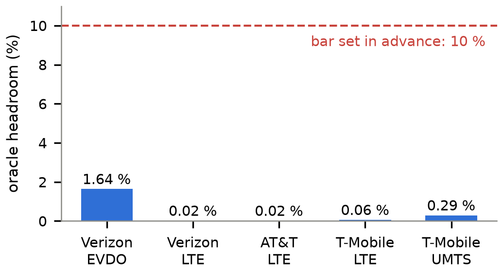
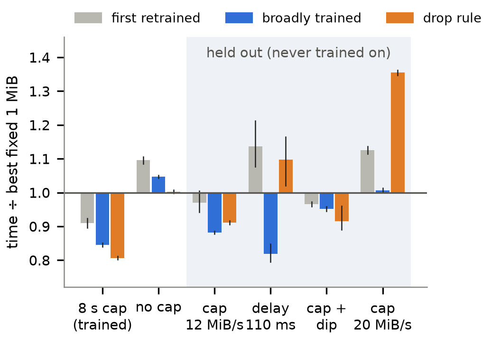
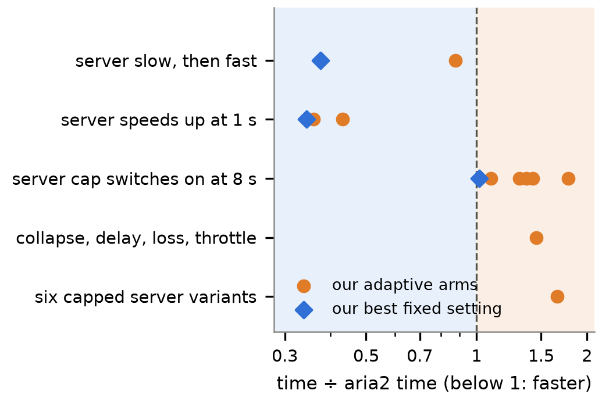
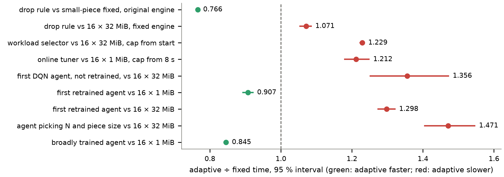

# Paper draft — working manuscript (claims corrected against raw data, 2026-10-11; engine ablation, online tuner and capped-server agent added 2026-10-25; baselines, sweep, joint agent and DQN v2 added 2026-10-26; framing, the adaptive-versus-aria2 synthesis, trace scope, authors and naming added 2026-10-28)

**Working title:** *When does adapting concurrency and range size help? Adaptive downloading versus aria2 and fixed settings under non-optimal conditions.*

**Evidence labels used throughout.** **Confirmed** = reproduced from raw run files
with the stated n; **Descriptive** = point estimate without an inferential claim;
**Failed gate** = a predeclared criterion that was not met; **Limitation** = scope
or validity caveat. Every number in this draft is recomputed from raw artifacts by
`tools/claims_check.py`.

**Note on "pre-registered".** Protocols in this project were written to logged
documents with recorded SHA-256 hashes before the corresponding runs. They were
not deposited with an independent timestamping service, the repository history
begins with a single import commit, and one manifest was amended twice after
design output had been seen (W1–W6, §6.1; the first version was overwritten).
Wording such as "pre-registered" in older internal documents therefore means
*predeclared in a logged protocol*, not independently verifiable pre-registration.
See `docs/PREREGISTRATION_NOTE.md`.

---

## Abstract

Adaptive HTTP range downloaders choose concurrency (N) and range size (S), but it
is rarely clear when adaptation has anything to exploit. We ask whether adapting N
and S during a download helps when network or server conditions are not optimal,
compared with aria2 and other segmented downloaders, and whether any gain comes
from adapting or from how the file is split. On a controlled platform, a fixed
configuration of our downloader (16 connections, 4 MiB ranges) completed
**62.4 % faster than aria2 1.37** on one characterised workload (30/30 paired
runs), a gap that controls attribute largely to request granularity and
request-start timing rather than to adaptation. On five replayed cellular traces a
counterfactual oracle found no exploitable concurrency headroom (one-sided 95 %
lower bound −0.26 % against a predeclared 10 % bar). Under a constructed server
whose per-request rate falls with concurrency, a causal controller was 23.4 %
faster than the best of three stationary configurations, but a 230-run ablation
showed that aria2's lead there came from two engine differences; with both fixed,
the best fixed configuration was faster than the controller (1.071 [1.054, 1.085]).
Learned policies were slower than aria2 overall, and a retrained DQN beat the best
fixed configuration only where it was trained (0.907 [0.893, 0.921]). Against aria2
under changing conditions, adaptive arms were faster only when the server rate rose
(0.36–0.88), where a fixed configuration of the same engine was faster still
(0.344–0.376), and slower whenever the server degraded (1.096–1.781). All results
are scoped to controlled mechanisms, not live networks or production servers.

## Extended abstract

Adaptive HTTP range downloaders choose concurrency (N) and range size (S), but it
is rarely clear when adaptation has anything causal to exploit. We ask
whether adapting N and S during a download helps when network or server
conditions are not optimal, compared with aria2 and other segmented
downloaders and with a well-chosen fixed configuration of the same engine,
so that a gain from adapting can be told apart from a gain from how the file
is split. We build a
controlled single-server HTTP/1.1 range-download platform with per-response
pacing, a soft concurrency-dependent throttle, and network impairment, and report
four findings. (i) On one characterised workload (512 MiB; per-response pacing
640→160→2500 KiB/s; netem 40 ms delay per direction, i.e. 80 ms RTT, and 0.4 % loss) a fixed configuration of 16
connections and 4 MiB ranges completes **62.4 % faster than aria2 1.37** (30/30
paired runs, geometric ratio 0.3756 [0.3726, 0.3787]); controls attribute much of
the gap to an interaction between request granularity, request-start timing, and
phase-locked pacing: it shrinks when granularity is matched (ratio 0.862). A
five-pair screen over six pacing schedules shows ours faster in 28 of 30 pairs,
with the ratio ranging from 0.38 to 0.81 and reaching parity (0.998) only at a
constant slow rate (640 KiB/s), so the advantage is not confined to the D2 phase
pattern; the direction was also observed against a stock NGINX server with
per-response rate limiting (ours faster in 10/10 pairs; screening, n=5 per
configuration). (ii) Replaying five recorded cellular traces
in a controlled setup, a counterfactual oracle finds no exploitable concurrency
headroom (one-sided 95 % lower bound −0.26 % against a predeclared 10 % bar).
(iii) Under a server model we constructed in which per-request rate falls with
concurrent connections, the optimum (N,S) moves between states and a causal
controller exploits it: within a download it is 23.4 % faster than the best of
three stationary configurations (10/10 paired blocks) but slower than aria2 under
that cap; across six predeclared workloads a frozen workload selector is not
distinguishable from the per-workload best fixed configuration on average
(geometric ratio 0.999 [0.969, 1.029]) and a consistent improvement over a single
family-wide configuration is **not** established (point estimate 0.770,
workload-level interval [0.455, 1.304]). A 230-run engine ablation then showed
that aria2's lead under that cap came from two engine differences in our
downloader, a whole-request timeout and the absence of straggler splitting;
with both fixed, our best fixed configuration matched aria2 with the cap from
the start (ratio 0.995 [0.992, 0.999]) and was within 1.6 % of it with the cap
from 8 s (1.016 [1.006, 1.029]), and the best fixed configuration was faster
than the causal controller (1.071 [1.054, 1.085]) and the workload selector
(1.229 [1.223, 1.234]). A re-implemented online concurrency tuner in the style
of FastBioDL was slower even than the better of two fixed configurations with
its own 1 MiB range size (1.212 and 1.220).
(iv) The DQN policies (v2, v5, v6) were slower than aria2 overall in the
head-to-heads we ran, and the frozen v6 agent was slower than the best fixed
configuration on the capped server (1.356 [1.252, 1.472]); a DQN retrained on a
simulator of that server, checked against blind live runs, beat the best fixed
configuration with its own range size where it was trained (0.907 [0.893, 0.921])
but in none of three held-out conditions outside its training ranges. Retrained
on a broader distribution with delay-dependent calibration (v2), it was faster
than the best fixed 1 MiB configuration in 3 of 4 new held-out scenarios inside
its training ranges and slower in 1 (by 0.7 %); it cost about 5 % with no cap,
and a simple drop rule tuned to the original cap was faster in its home scenarios.
A joint agent that also set the range size did not beat the best fixed
configuration live (1.471 [1.405, 1.546] under the cap). (LinUCB was evaluated
only descriptively.) Against aria2 under changing conditions, our adaptive arms
were faster only when the server rate rose during the download (0.36–0.88),
where a fixed configuration of the same engine was faster still (0.344–0.376);
when the server degraded, aria2 was faster than every adaptive arm
(1.096–1.781). All results are scoped to the
controlled mechanisms; none is a validation on live networks or production servers.

---

## 1. Introduction

- Segmented range downloads; fixed vs adaptive N and S. Tools such as aria2,
  axel and lftp choose N and S once, at the start of a download.
- **Question.** When network or server conditions are not optimal (the
  server rate changes, the server starts throttling, delay and loss, a link
  whose capacity swings), does adapting N and S during the download do better
  than these tools? And is any gain due to adapting, or to how the file is
  split? To separate the two, every adaptive arm is compared with aria2 and
  with the best fixed configuration of the same engine.
- Adaptation is useful only when the environment has a state-dependent optimum
  that a causal controller can observe.
- **What is not new.** Online tuning of parallel streams (FastBioDL, Falcon,
  direct search), deep RL for transfer parameters, and splitting slow
  segments (aria2, IDM) are established; we propose no new tuning algorithm.
- Contributions (each with its evidence label):
  1. The answer to the central question: a synthesis against aria2 and the best fixed setting under changing conditions (§9e, §10); adaptive arms won only when the server rate rose, where a fixed setting of ours won by more, and lost whenever the server degraded.
  2. A controlled, instrumented platform (downloader, server with explicit
     rate rules, policies, harness) and a claims checker that recomputes every
     number in this paper from raw artifacts.
  3. A partly mechanism-explained comparison with aria2 on one characterised workload
     (**Confirmed**, single workload; sensitivity screen in §4.1), whose
     direction also held against axel and lftp and across a delay × loss grid
     (screens, §4.3, §4.4).
  4. A replay-based negative result on recorded cellular traces, with the
     oracle headroom bounded before any learner was trained (**Confirmed**
     under the frozen counterfactual model; not a live-network validation).
  5. Existence results for adaptive (N,S) selection/control **under an explicitly
     constructed N-dependent server model** (§6, §7): within-download improvement
     over the best stationary configuration (**Confirmed**, n=10 blocks);
     cross-workload selection (**Descriptive**; consistency across the family not
     established).
  6. An engine ablation showing that a whole-request timeout and missing
     straggler splitting, not control, explained aria2's lead under the cap,
     after which the best fixed configuration beat the adaptive controllers
     (**Confirmed**, §7a); and a live-rate control server showing that the
     large-range advantage depends on the server fixing a response's rate on
     arrival (§9c).
  7. An inventory of learned-policy experiments (§9): the early candidates are
     negative or descriptive; agents retrained for the capped server beat the
     fixed configuration with their own range size where trained, generalized
     partially inside a broadened training envelope, and failed a no-harm
     check on public mirrors (§8a).
- Scope: controlled server/network mechanisms; not claims about production servers.

## 2. Related work

All entries below were checked against an authoritative record; see
`reports/references.md` for the verification log and the list of unresolved
candidates, which are deliberately not cited.

**Online tuning of transfer parallelism.** Balaprakash et al. [balaprakash2016direct]
treat the number of parallel streams as an online optimization problem solved by
direct search on production GridFTP/Globus links. Falcon [arifuzzaman2023falcon,
arifuzzaman2021online] tunes the degree of parallelism with a utility function
and online search for high-speed science networks. FastBioDL
[swargo2025fastbiodl] applies gradient-descent concurrency tuning to HTTP/FTP
genomic downloads (arXiv preprint, no peer-reviewed venue found). These works
optimize concurrency online against observed throughput; the present paper
instead asks, with a controlled server whose mechanism is known, whether an
optimum exists for a causal controller to track at all.

**Multi-source and range-based downloading.** MDTP [abdollah2025mdtp] splits a
request into chunk requests across replica servers and sizes chunks to measured
per-server throughput, comparing against aria2 [aria2manual]. HTTP range
requests are specified in RFC 9110 [rfc9110]. Our setting is single-source.

**Adaptation in adjacent domains.** BOLA [spiteri2016bola, spiteri2020bola]
selects video bitrates by utility maximization without bandwidth prediction and
serves as an analogy for decision rules that need no throughput forecast.
DeLoad [liu2025deload] (preprint) sizes download tasks for short-video
preloading. Neither is a range-download concurrency study.

**Position.** The contribution here is a mechanism-first, controlled
evaluation with explicit failed gates and a practical baseline comparison, not
a new tuning algorithm.

## 3. System and experimental platform

- Go downloader: RangeTracker (half-open), fetcher (inclusive), assembler,
  metrics, worker pool (dynamic N, in-flight ranges immutable), concurrency and
  chunk-size controllers, policy interface, serialized policy runner.
- Controlled server: deterministic logical object; per-response pacing sampled at
  **request start and held for that response**; wall-clock rate schedules; fault
  injection; and a soft concurrency cap
  `rate_eff = min(base, C/(k*(1+gamma*(k-1))))` evaluated at request start with
  k = concurrent requests including the arriving one (C = 8 MiB/s and
  gamma = 0.05 were chosen in an exploratory screen of 27 schedule–cap pairs,
  of which one met the selection rule). This request-start semantics is a
  property of the server model and drives the aria2 results below. An opt-in
  live-rate mode instead re-evaluates each response's rate during the response
  from the current k; it serves as a control in §9c.
- Harness: experiment matrix, aria2/curl/wget runners, SHA-256 content
  verification of every output, tc/netem [tcnetem], and Mahimahi mm-link
  trace replay [netravali2015mahimahi].

## 4. Phase-locked pacing and the aria2 comparison

- Workload D2: 512 MiB, per-response pacing 640 → 160 → 2500 KiB/s at 2 s / 4 s,
  netem `delay 40ms loss 0.4%` on loopback, which applies in both directions
  (measured RTT 80 ms; earlier drafts said "40 ms RTT"); both systems receive
  the same object.
- Frozen configurations (selected on separate discovery runs): ours (16 conn,
  4 MiB); aria2 1.37 `--max-connection-per-server=16 --split=16
  --min-split-size=1M`. The full aria2 split frontier (1/2/4/8/16) and a
  40-configuration grid for ours were run in discovery.
- **Confirmed (30 fresh pairs):** ours 20.12 s vs aria2 53.56 s mean; geometric
  ratio 0.3756, 95 % CI [0.3726, 0.3787], 30/30 wins; all runs content-verified.
- **Mechanism (per-request server logs, per run):** aria2 issues 16 requests (one
  unranged probe plus 15 × 32 MiB ranges), all starting before 2 s and held at
  640 KiB/s; ours issues 128 × 4 MiB ranges, of which 16 start before 2 s and 112
  start after 4 s in the recovered phase (3840 ranged requests, 480 early / 3360
  late, over 30 runs). aria2 cannot be configured to finer
  initial pieces: with `-x16`, `--split` of 16/64/256 gave the same range-size
  distribution in a local probe.
- **Controls:** granularity-matched control ratio 0.862 [0.834, 0.890] (10
  pairs). A constant 2.5 MB/s schedule removes most of the *4 MiB vs 32 MiB*
  difference within our own downloader (2.3× → 1.1×) but ours is still faster
  than aria2 (15.3 s vs 24.8 s); see §4.1. The phase-locked mechanism therefore
  explains the size of the D2 gap, not the whole of it.
- **This is a fixed-configuration result, not an adaptive one:** neither system
  adapts during the transfer in this comparison.
- **Limitation:** one workload family on a synthetic server; the win is a
  property of this pacing mechanism, not a general statement about aria2.

### 4.1 Pacing-schedule sensitivity (screening)

Frozen protocol: `testdata/d2_pacing_sweep/manifest/sweep_manifest.json`
(committed before any run; order seed 20261011; exclusion rules fixed).
Same workload, systems, and netem as §4 (512 MiB; ours 16 conn × 4 MiB; aria2
frozen flags); only the server pacing schedule varies. **Screening only: five
pairs per schedule, no inferential claim.** 60/60 runs valid, 0 exclusions,
all content-verified.

| schedule (KiB/s; switch times s) | ours (s) | aria2 (s) | geo ratio ours/aria2 | [min, max] | ours faster |
|---|---|---|---|---|---|
| S0 D2 reference `640,160@2,2500@4` | 20.1 | 53.3 | 0.378 | [0.372, 0.389] | 5/5 |
| S1 no dip `640,2500@2` | 20.1 | 48.9 | 0.425 | [0.353, 0.751] | 5/5 |
| S2 long dip `640,160@2,2500@8` | 44.1 | 54.7 | 0.806 | [0.783, 0.827] | 5/5 |
| S3 partial recovery `640,160@2,1280@4` | 31.6 | 54.3 | 0.583 | [0.559, 0.608] | 5/5 |
| S4 constant fast `2500` | 15.4 | 27.1 | 0.568 | [0.523, 0.618] | 5/5 |
| S5 constant slow `640` | 53.8 | 53.9 | 0.998 | [0.987, 1.008] | 3/5 |

Both predeclared expectations held: S0 reproduces the historical D2 ratio
(0.378 vs 0.3756) and S5, where both systems run 16 connections at one slow
rate, is at parity. Beyond that the screen is descriptive: the advantage is
largest when the early slow phase is short relative to the transfer (S0, S1),
shrinks when the slow phase lasts longer (S2, 0.806), and persists under
constant fast pacing (S4, 0.568), where no phase-locking exists. The sweep did
not test why S4 favours the smaller ranges (an obvious candidate is the
finishing tail of 32 MiB pieces, unmeasured here), so the mechanism for S4 is
a hypothesis, not a finding. S1 has one pair at 0.751 (a slow ours run); it is
retained under the predeclared exclusion rules.

### 4.2 Stock-server check (NGINX `limit_rate` / `limit_rate_after`)

Purpose and scope: a separate screen of whether the *direction* of the aria2
comparison survives on a stock server whose rate control we did not write. It
is **not** a shared or concurrency-dependent cap: NGINX 1.24.0 `limit_rate`
limits each response independently and `limit_rate_after` leaves the first bytes
of each response unthrottled; there is no concurrency-dependent behaviour and no
connection limit. Frozen protocol:
`testdata/nginx_limit_rate/manifest/nginx_manifest.json` (committed before any
run). Same 512 MiB object (deterministic AES-CTR stream, SHA-256 verified),
netem, systems and aria2 flags as §4; 5 pairs per configuration; screening only.
20/20 runs valid.

| configuration | ours (s) | aria2 (s) | geo ratio ours/aria2 | [min, max] | ours faster |
|---|---|---|---|---|---|
| N1 `limit_rate 640k` (constant per response) | 50.3 | 58.3 | 0.863 | [0.811, 0.901] | 5/5 |
| N2 `limit_rate_after 1m; limit_rate 640k` | 33.7 | 56.4 | 0.597 | [0.574, 0.625] | 5/5 |

The predeclared expectation for N1 was parity (both systems use 16 connections
at one per-response rate, as in sweep schedule S5, which gave 0.998). **That
expectation was not met**: ours was faster in all five pairs. The check does not
identify why; the difference between S5 and N1 could come from the server
implementation (NGINX/sendfile pacing granularity), aria2's request handling
against NGINX, or the two systems' connection behaviour, and none was tested.
The result supports only the statement that the direction of the comparison
(ours faster) was also observed on a stock server under per-response rate
control in this setup.

### 4.3 Other segmented downloaders (axel, lftp)

A frozen screen (`testdata/baselines_ext/protocol.md`) added axel and lftp
`pget` next to aria2, all at 16 connections, on the same server models and
netem. HEAD requests were answered at once, so no tool paid for a paced
probe. 5 blocks per scenario, 80 runs, all valid. wget2 was planned and
then removed (amendment A2): it fetches one file over a single connection
however it is configured. We confirmed this in its source; upstream issue
#195 describes the same behaviour.

| Scenario | Ours (setting) | ours ÷ axel | ours ÷ lftp | ours ÷ aria2 |
|---|---|---|---|---|
| HEALTHY (t1, no cap) | 16 × 1 MiB | 0.345 [0.344, 0.347] | 0.345 [0.344, 0.346] | 0.357 [0.344, 0.371] |
| D2 | 16 × 4 MiB | 0.375 [0.373, 0.378] | 0.374 [0.369, 0.377] | 0.375 [0.373, 0.377] |
| CAP8 | 16 × 32 MiB | 1.003 [0.965, 1.026] | 1.001 [0.963, 1.024] | 0.996 [0.960, 1.017] |
| CAP0 | 16 × 32 MiB | 1.025 [1.021, 1.029] | 0.597 [0.594, 0.599] | 0.995 [0.992, 0.998] |

- **Reading.** axel and lftp split the file into 16 equal parts at the
  start, as aria2 does. They gain nothing from a pacing schedule that rises
  after the first second, so the §4 gap is not specific to aria2: it applies
  to tools that split the file once, up front.
- **Under the cap, all four were level** at about 53 s. With the cap from
  the start, lftp took 114 s because it never re-splits a slow part (our
  engine without splitting behaved the same way, §7a), and axel was 2.5 %
  faster than ours.
- **Screen only:** 5 blocks on constructed server models.

### 4.4 Delay and loss sweep (screen)

A frozen sweep (`testdata/netem_sweep/protocol.md`) repeated two
comparisons over a grid of one-way delays (10, 40, 100 ms) and loss rates
(0, 0.4, 2 %). It used 3 blocks per cell, 108 runs, all valid.

- **D2 (16 × 4 MiB against aria2):** ours was faster in every block of all
  9 cells, with cell geometric means from 0.362 to 0.457. The direction
  holds across the grid, by the predeclared rule.
- **CAP8 (16 × 32 MiB against aria2):** the direction does not hold.
  - 5 cells were mixed, and 2 had aria2 faster in every block: 10 ms with
    2 % loss (1.073) and 40 ms with 0.4 % loss (1.035).
  - At 100 ms, ours was faster with 0 and 0.4 % loss (0.769 and 0.955) and
    mixed with 2 % loss.
  - So under the cap the two are near parity, and the sign depends on the
    network.
- **Screen only:** 3 blocks per cell on one machine. No claim about real
  networks.

## 5. When does adaptation help? Mechanism screens

Predeclared screens, each closed before policy work: static rate+RTT (chunk size
moves, no causal switching gain; analytical), live queueing (work-conserving; no
joint opportunity), correlated loss (no joint opportunity; N monotone. An
earlier "S fragile" reading was an artefact of a modelled 30 s request
deadline: re-simulated without it, S* = 16 MiB in all 9 variants, with no
failures), failure-based
N-dependent throttling (abort cliff), and adaptive-N degradation (interior
optimum analytically; live mismatch). Existing adaptive heuristics on D2 adapt
but lose to the fixed optimum (joint 2.32× slower). **Conclusion:** within-download
adaptation needs a mechanism whose optimum moves in N and S and is causally
observable; none was found live in the screened mechanisms other than the
constructed soft cap of §6–§7. The same screens searched a space of server
behaviours (72 cap candidates in §6.1 alone); results in §6–§7 are existence
demonstrations in a selected environment, not prevalence estimates.

## 6. Cross-workload selection under the constructed cap

- Family: healthy server vs concurrency-capped server (C=8 MiB/s, gamma=0.05);
  stationary optima (16, 1 MiB) vs (4, 4 MiB); cross penalties +35.8 % / +252.9 %.
- Live mechanism gate (**Failed gate**; five of six predeclared checks passed):
  N* moved 16→4 and S* moved 1→4 MiB (N-margin 5.75 %, just above its 5 % bar),
  and cross-state penalties were material (+31.8 % using the healthy optimum under
  the cap; +254.4 % using the capped optimum when healthy). The local S-margin was
  3.73 % in the gate grid (3.74 %, 95 % bootstrap [3.09 %, 4.45 %], after four
  extra replicates) against a predeclared 5 % criterion; the criterion was not
  changed. Three high-N/large-S capped cells aborted at the 30 s request timeout
  and are preserved as invalid (a 20/30/60 s timeout screen left the optimum at
  (4, 4 MiB) and changed only reachability).
- Selector: probe at (16, 1 MiB), classify after ≥ 20 samples, apply the
  predeclared (N,S), no further switching. Live, 10 blocks per workload:
  healthy 19.1 s vs fixed (16,1M) 19.0 s (geo 1.006 [0.931, 1.082], 6/10) and vs
  aria2 53.9 s (geo 0.353, 10/10); capped 84.2 s vs fixed (16,1M) 115.3 s
  (geo 0.730, 10/10) and vs aria2 68.3 s (geo 1.232, 0/10: aria2 faster).
- Baselines, stated explicitly: vs the best single fixed configuration across the
  two workloads (8, 4 MiB; 36.3 s / 91.7 s) the selector gains +47.5 % / +8.2 %
  (**Descriptive**; the two workloads were designed to have different optima);
  vs the per-workload best fixed it is −3.5 % healthy and +2.6 % capped.

### 6.1 Six-workload family

Frozen manifest `testdata/n_dependent_server_joint_ns/manifest/w1_w6_manifest.json`
(predeclared in a logged protocol, but not independently timestamped):
six predeclared workloads (W1 healthy; W2–W6 cap/schedule/transition variants)
chosen by a predeclared qualification and selection rule from 72 analytic
candidates (13 qualified). Two post-hoc amendments were made after design output
and before any live W1–W6 run (post-drop window 20 samples → fixed 25 s; relaxed
transition coverage); the first manifest was overwritten and is not preserved.
W2–W4 share one selector target by construction. Live fixed-grid validation: 5/6
model optima matched; **W5 mismatched** (live argmin (16,16M) 85.4 s; the model's
target (4,4M) measured 95.9 s live against a model prediction of 94.8 s) and the frozen selector was not retuned. 10 fresh paired blocks per
workload, 240 runs, 0 invalid.

| comparison (selector vs …) | pooled geo ratio | block-level 95 % CI | workload-level (six-cluster) interval | blocks won |
|---|---|---|---|---|
| per-workload best fixed | 0.999 | [0.969, 1.029] | [0.873, 1.143] | 24/60 |
| family-best single fixed (4, 4 MiB) | 0.770 | [0.684, 0.859] | [0.455, 1.304] | 40/60 |
| aria2 | 1.660 | [1.360, 1.990] | [0.707, 3.901] | 10/60 |

**Primary comparison is the workload-level interval**, because the unit of
generalisation is the workload, not the block. It includes 1 for all three
comparisons. The 0.770 point estimate is therefore **Descriptive**: a consistent
improvement over a single family-wide configuration across the family is **not
established**. It is driven by W1 (healthy workload vs a degraded-state fixed
configuration; ratio 0.286); over W2–W6 the geometric mean is 0.94 and the
selector loses on W5 (1.058) and W6 (1.090).

| workload | vs per-workload best fixed | vs family-best fixed |
|---|---|---|
| W1 | 1.013 | 0.286 |
| W2 | 0.934 | 0.869 |
| W3 | 1.019 | 0.949 |
| W4 | 0.808 (selector runs the fast (16,1M) config until the cap appears: probe-phase timing, not better selection) | 0.765 |
| W5 | 1.172 (frozen-target mismatch) | 1.058 |
| W6 | 1.088 | 1.090 |

aria2 is faster on every degraded workload (its burst-started 32 MiB pieces start
before the cap rate drops, §7). The result is workload-level selection under the
constructed cap, not within-download adaptation.

## 7. Within-download adaptation under server degradation

- State schedule: no cap on [0, 8 s), cap on [8 s, EOF). Controller: running max
  of windowed median per-request throughput; on a drop below 0.5×, switch once to
  a predeclared target ((4,4M) joint; (4,1M) N-only; (16,4M) S-only).
- **Confirmed (10 paired blocks, 0 invalid):** causal joint 58.7 s vs best of the
  three stationary configurations run under this schedule, (16,1M) 76.7 s: geo
  0.766 [0.762, 0.769], 10/10 (+23.4 %). The comparison set is
  {(16,1M), (4,1M), (4,4M)}; no fixed grid was run under this schedule, so
  "best" means best of those three.
- Ablation: N-only 62.0 s (geo 0.808 vs best fixed, 10/10); joint vs N-only geo
  0.947 [0.943, 0.952], 10/10; S-only 82.1 s, worse than not switching (geo
  1.070, 0/10). Under this cap the N move carries the gain.
- **aria2 is faster:** 53.6 s vs causal joint 58.7 s (geo 1.096, 0/10). This
  result supports improvement over the best stationary configuration under the
  selected controlled transition, **not** superiority over aria2. Mechanism
  (per-request server logs): aria2's first nine pieces start at k ≤ 9 where the
  cap rate exceeds the base rate and hold 640 KiB/s for ~52 s; the server fixes a
  request's rate at its start.

- Block-level CIs here are very narrow because the emulated server is nearly
  deterministic; they quantify emulator noise, not population variability.
- **Superseded explanation of the aria2 gap.** §7a shows that the gap came
  mainly from two engine details of our downloader, not from aria2's piece
  timing alone, and that against the best fixed configuration on the corrected
  engine the causal controller is slower.

## 7a. Engine ablation: why aria2 led under the cap

An audit found two engine differences between our downloader and aria2:
(a) every request had a 30 s whole-request deadline, which aborts a large range
that is slow but progressing, and (b) in-flight ranges were never split, while
aria2 lets an idle connection take half of the slowest segment's remaining
bytes. Both were made opt-in options (`NoRequestTimeout`, `SplitStragglers`,
default off; a split needs at least 2 MiB unreceived) and tested in a
predeclared ablation (`testdata/split_ablation/protocol.md`): four scenarios
(cap from the start, CAP0; cap from 8 s, CAP8; no cap; the D2 pacing workload)
× 10 shuffled blocks, 230 runs, all valid, with zero failed attempts, retries
or wasted bytes on the client side. (The server logs do show aborted
requests. These are the unreceived tails of ranges that were split, cut off
when the client closes them; the client discards no bytes it received.)

- **Splitting was the main cause (Confirmed, 10 blocks).** Under CAP0 the same
  16 × 32 MiB configuration took 40 % less time with splitting (0.599
  [0.598, 0.601]) and then matched aria2: 68.2 s against 68.5 s, 0.995
  [0.992, 0.999], detectable but practically negligible.
- **Large ranges need the deadline removed (Confirmed).** Under CAP8,
  16 × 32 MiB without the deadline took 0.711 [0.703, 0.719] of the time of
  the earlier best fixed configuration (16 × 1 MiB), and was within 1.6 % of
  aria2 (54.4 s against 53.5 s, 1.016 [1.006, 1.029]).
- **No harm elsewhere.** With no cap and on D2 the corrected and original
  engines were not distinguishable (0.981 [0.931, 1.011]; 0.995 [0.987, 1.003]),
  and ours remained much faster than aria2 there (0.344 and 0.370).
- **Adaptation against the corrected baseline.** The causal controller of §7
  replicated against its original comparison set (0.767 [0.764, 0.769]), but
  against the best fixed configuration on the corrected engine (16 × 32 MiB)
  it was slower (1.071 [1.054, 1.085]); under CAP0 the workload selector of §6
  was slower than 16 × 32 MiB (1.229 [1.223, 1.234]).
- **Mechanism.** The server fixes a response's rate when the request arrives.
  Under CAP8, 16 × 32 MiB starts all 16 ranges before the cap, so every range
  keeps the pre-cap rate; splitting then hands the tail to idle connections.
  This is a property of our server model; a server that re-evaluates rates
  during a response could change it.

## 7b. Online concurrency tuning (prior-work re-implementation)

FastBioDL-style online tuning [swargo2025fastbiodl] was re-implemented as a project
policy (not their code): aggregate throughput T over 2 s windows, utility
U = T/K^N, keep the step direction while U improves, reverse and halve on a
drop above 5 %, clamp at N in 1–16, S untouched. Predeclared protocol
(`testdata/online_tuner/protocol.md`): CAP8 and no cap, 8 shuffled blocks, 64
runs, all valid, corrected engine.

- **Slower than the better of the two fixed 1 MiB configurations in both
  scenarios (Confirmed).** CAP8: 1.212 [1.180, 1.248] against 16 × 1 MiB; no
  cap: 1.220 [1.203, 1.232]. The tuner keeps the range size at 1 MiB, so these
  are same-range-size comparisons; under CAP8 the corrected engine's best
  fixed configuration (16 × 32 MiB, §7a) was faster still.
- **Adaptation speed (Descriptive).** It cut N 2.1 s after the cap (the causal
  controller 1.5 s), but needed 8.1 s to climb from N = 4 to N = 16 without a
  cap, and that ramp is where most of the loss occurs.

## 8. Recorded cellular traces replayed in a controlled setup

Five recorded driving traces (Verizon EVDO and LTE, AT&T LTE, T-Mobile LTE and
UMTS), recorded with the Saturator tool of Winstein et al. [winstein2013sprout]
and distributed with Mahimahi [netravali2015mahimahi], were replayed through
mm-link on a controlled host; this is trace replay,
not measurement on live mobile networks. A per-trace counterfactual oracle with
transition costs estimates the completion-time headroom of switching concurrency
over the best fixed C. Headroom per trace: 1.64 %, 0.019 %, 0.016 %, 0.061 %,
0.294 % (mean 0.406 %). The predeclared gate required a one-sided 95 % lower bound
≥ 10 %; the bound was −0.26 % (**Failed gate**; n = 5, df = 4). Oracles are not
policies; this bounds the benefit available to any concurrency-switching policy
under the frozen model.

**What the traces vary.** Each trace lists the times at which the recorded
link could deliver one 1500-byte packet. In 1 s bins, downlink capacity swings
by a 90th/10th percentile ratio of 6.5 to 25.3 across the five traces
(Verizon EVDO 24.2, Verizon LTE 14.1, AT&T LTE 6.6, T-Mobile LTE 6.5,
T-Mobile UMTS 25.3; `tools/trace_swing.py`). The replay ran `mm-link` with the
trace alone, without `mm-delay` or `mm-loss`, so it varied capacity only: no
added propagation delay, no random loss, and no server behaviour. Loss and
delay were studied separately with netem (§4.4, §5). On one shared bottleneck
whose capacity varies, the best N stays roughly "enough to fill the pipe",
because every setting slows down together. A capacity trace cannot express a
per-connection cost that changes over time, which is the mechanism §6–§7
construct.

### 8a. Live-internet pilot (Descriptive)

To check whether the trace-replay conclusion survives contact with real
paths, we ran a small descriptive pilot (`testdata/live_pilot_l1/`; protocol
committed before the first slot, with amendments logged). One client on the
author's residential broadband in India downloaded a kernel.org release
tarball from four public mirrors: the kernel.org CDN, the kernel.org origin
mirror, and university mirrors in Japan and China. Each download used one of
eight fixed (N, S) cells (N in {1, 4, 8, 16}, S in {1, 4} MiB), and aria2
and a single-stream curl reference ran alongside. There were two reps per
cell per server in four time-of-day slots on the primary access network
(Sunday midday, Sunday evening, Monday evening, Tuesday morning), plus a
re-run of the midday slot for the Tsinghua mirror (amendment A2). Every file
was checksum-verified and invalid runs were kept. A condition is one
(server, slot) pair.

- **Validity:** 328 of 350 runs valid. The invalid runs are the 16
  downloader runs that the Tsinghua mirror refused with HTTP 403 in the first
  slot (see below), and 6 runs during an internet drop at the start of the
  first Tuesday attempt, which was then re-run in full (amendment A4). The
  fastest valid run reached 2.43 MB/s, which is the access link's ceiling.
- **Best fixed cell per condition:** no single cell was top everywhere, but
  the top cell always had N of 8 or more, except for 4 × 1 MiB on the CDN in two
  slots and 4 × 4 MiB on the Tsinghua mirror in one. The top cell changed
  across slots on 4 of 4 servers. How many connections were "enough" depended
  on the server. On the origin mirror, the better of the two N = 4 cells was
  1.37–1.71× slower than that condition's best in every slot, and N = 1 was
  slower still.
- **Selection headroom:** one global cell, 8 × 1 MiB, was on average 3.7 %
  slower than each condition's clairvoyant best (95 % bootstrap over
  conditions [1.0, 4.8]; 16 conditions). It was within 5 % of the best in 11
  of 16 conditions and at most 15.3 % slower in any one, with two reps per
  cell. No condition was access-link-bound by the protocol's definition,
  because N = 1 was always more than 5 % slower than the best, so the
  headroom excluding such conditions is identical.
- **Within-run variability:** median coefficient of variation of 1 s
  throughput bins 0.11–0.29 across servers.
- **Context:** aria2's time ratio over the condition's best fixed cell was
  1.00–1.26.

In this pilot, one fixed configuration (8 × 1 MiB) was near-best across all
observed conditions: the bootstrap upper bound of 4.8 % is below the
predeclared 5 % line. This supports, but does not prove, the thesis that
real-condition variability did not move the best setting. The bound is
close to the line, and individual conditions deviated by up to 15.3 %, so
this is a screening result. A side observation: the Tsinghua mirror
rejected the Go standard library's default User-Agent with HTTP 403 for
every range request, while accepting curl, aria2 and an identifying
User-Agent. The downloader's runs against it therefore used an explicit
User-Agent (amendment A2).

One morning slot ran by accident on a second, unidentified access network
(amendment A3). It is reported separately and is never pooled with the
primary conditions. On that network 68 of 80 runs were valid. The failures
were DNS and retry exhaustion, clustered in about half an hour of unstable
connectivity. Peak throughput was 12.3 MB/s, and within-run variability was
far higher (median coefficient of variation 1.16–1.77). The same global
cell, 8 × 1 MiB, had 7.2 % headroom (bootstrap [1.2, 12.2]; 4 conditions;
within 5 % of the best in 2 of 4). This single slot does not meet the
predeclared small-headroom criterion. With four conditions from one
partially unstable slot it is inconclusive, but it is the one place in the
pilot where the best setting may have moved by more than 5 %.

The pilot has one client and one primary access network. Its slots span
about two days, and CDN and mirror behaviour may change over time. It is
screening evidence that a fixed configuration with enough connections was
near-best on the observed paths. It does not validate the findings across
networks.

**Adaptive arms on the same mirrors (descriptive no-harm check,**
`testdata/live_mirror_check/protocol.md`**).** After the loopback studies, the
v2 agent of §9d and the C=8-tuned drop rule ran on three of these mirrors
(kcdn, kedge, riken). Each was compared with fixed 16 × 1 MiB and 8 × 1 MiB:
the same corrected engine, 5 blocks, 64 MB.

- **The first slot was lost to the client's own link.** From 22:10 UTC
  every attempt to all three servers failed with no response, and only 20
  of 60 runs were valid. It is reported in full and not used (amendment
  A2).
- **The second slot ran after a predeclared link check, and 60 of 60 runs
  were valid.** v2 against the better fixed arm:
  - kcdn: 1.401 [1.102, 1.773], slower;
  - kedge: 1.654 [0.873, 2.849];
  - riken: 1.215 [0.719, 1.899].
  The drop rule against the better fixed arm:
  - kcdn: 1.125;
  - kedge: 1.063;
  - riken: 1.332.
  Only the kcdn v2 interval excludes 1. Under the frozen rule, "no harm"
  needs a ratio of at most 1.05 that is not slower, and both arms showed
  no harm on 0 of 3 mirrors.
- **What happened.** The mirrors have no cap, but both arms cut their
  connections: v2 ended at a median N of 6–7 on kcdn and kedge, and the drop
  rule switched to N = 4 in 4 of 5 runs on kedge and on riken. Our reading,
  not tested against the throughput traces, is that noisy per-request
  throughput looked like a cap.
- **Reading.** The agents adapt to signals that, on these servers, do not
  mean what they meant on the server model they were built for. Adaptation
  carried a cost here, with little selection headroom to pay for it (3.7 % in
  the pilot).
  This matches §8, where variability did not mean opportunity. It is one
  client, one evening and 5 blocks of a noisy link, so it is descriptive
  only.

## 9. Learned-policy experiments (inventory; positive results only in §9b and §9d, both scoped)

The learners are a LinUCB contextual bandit [li2010linucb] and Double DQN
[vanhasselt2016ddqn] agents in the DQN family [mnih2015dqn], all acting through
the same serialized policy interface as the deterministic controllers.

**What the learners see, do and are rewarded for.** One decision is taken after
each completed request, through the serialized policy interface. A decision
changes only the target for future requests; a request already in flight is
never resized or cancelled.

| learner | sees | can do | rewarded by |
|---|---|---|---|
| LinUCB | 10 normalised features: current N and S, per-request and aggregate throughput, request duration, bytes transferred, and the counts of successful requests, failures, retries and attempts | 5 actions: nothing, N up, N down, S up, S down | a weighted sum: aggregate throughput, its change since the previous decision, request latency, retries, failures, and a cost for an action that really changed a target |
| DQN, cap-trained (§9b, §9d) | 13 features: N, remaining-bytes fraction, aggregate throughput with its smoothed value, slope and volatility, request duration and its slope, recent failure and retry rates, completed requests in the window, throughput change, time since the last change of N | 3 actions: nothing, N up, N down (range size fixed at 1 MiB) | minus the seconds between a decision and the next completed request, undiscounted, so the return of an episode approximates minus the download time |
| DQN, joint (§9c) | the same family of features with the range size added | 5 actions: as LinUCB | as the cap-trained DQN |

Aggregate (wall-clock) throughput is in every state because per-request
throughput does not depend on N, so a learner could not tell what a change of N
did; this was checked before any agent was benchmarked. The reward has no tuned
weights for the DQN agents: failures and retries lower the return only by taking
time. The DQN agents are trained in a simulator of the server and run inside the
Go downloader; LinUCB runs inside it directly.

**Naming.** "DQN v1–v6" in the table below are the early candidates. The
agents of §9b and §9d are a separate pair retrained for the capped server,
called the cap-trained v1 and cap-trained v2: the cap-trained v2 of §9d is not
the early DQN v2 of the table.

Status column: **valid** = the stated comparison is internally consistent and
reproducible from its artifacts; **stale** = produced before a later correction
of its simulator/environment; **non-comparable** = different workload, file
size or aria2 configuration from the other rows, so ratios must not be pooled.

| experiment | design | outcome | status |
|---|---|---|---|
| LinUCB, five- and six-mode 4 MiB benchmarks | 300 runs, 5 scenarios, fixed/rule-based/LinUCB modes | descriptive; locks onto a single arm after warm-up; periodic exploration changes coverage but not the dominant preference; no ranking made | valid (descriptive), non-comparable to aria2 rows |
| DQN v1 (frozen candidate) | simulator train/validation/test + 25-run live transfer, no aria2 comparison | superseded; trained on the v1 environment later corrected (§22.24) | stale |
| DQN v2 vs aria2 baseline v1 | 240 pairs, U1–U8 profiles, 4 MiB, aria2 `-x4 -s4` | 75.7 % slower (geo 1.757 [1.672, 1.847]); faster in 31/240 pairs | valid; non-comparable to the 16 MiB rows |
| DQN v3 | simulator + live transfer vs v2 | fixed fragmentation, but simulator rewarded chunk sizes the server does not reward | valid (negative/mixed) |
| DQN v4 (concurrency-only, fixed 1 MiB) | simulator + 25-run live transfer, no aria2 comparison | live behaviour matched simulator; 4 MiB file gave only a four-request control horizon | valid; no head-to-head |
| DQN v5 vs aria2-F | 240 pairs, 16 MiB, U1–U8 | geo 2.322 [2.230, 2.417]; faster in 1/240 pairs; outperformance criteria not met | valid as a head-to-head; **candidate artifact stale** with respect to a later simulator window-accounting fix (not retrained) |
| DQN v6 (concurrency 1–16) vs aria2-F | 150 pairs, trajectories A2–E2, 16 MiB | pooled geo 1.456 [1.305, 1.624]; faster in 37/150; one of five trajectories not slower (E2, 0.948 [0.897, 1.002]); D2 5.47× slower | valid; non-comparable to v5 rows (different bounds/trajectories) |
| v6 long-duration diagnostic | 16/128/512 MiB, 5 pairs/cell, A2/D2/E2 | pooled 1.805 → 1.062 → 0.909 (512 MiB CI [0.750, 1.102] includes 1), driven by D2 (6.00 → 1.16 → 0.568) while A2 and E2 worsen with size | valid but exploratory, small n |

No learned policy outperformed the practical baseline in a supported
comparison. Two features of these head-to-heads worked against the learned
policies regardless of what they learned:
- **Short downloads.** The files were 4–16 MiB, so most runs lasted only a
  few seconds.
- **Ramped start.** v6 started at one connection and ramped up, while aria2
  opened all of its connections at once.

The startup cost is therefore a large share of each run. The long-duration
diagnostic shows the pooled gap shrinking with file size, but it does not
remove the gap per trajectory. These comparisons test the frozen candidates
as built; they do not show that a learned controller cannot match aria2. The single sub-1 pooled value (v6 at 512 MiB) has an interval that
includes 1 and is driven by one trajectory. Candidate artifacts are frozen with
SHA-256 hashes; none was tuned after its evaluation. Intervals in this table are
95 % t-intervals on the log ratio recomputed by `tools/claims_check.py` with the
critical value for the actual degrees of freedom; the frozen analysis script
(`python/analyze_final_evaluation.py`) used 2.045 for every n (and the frozen D2
analysis used the normal value 1.96, giving [0.3728, 0.3785] instead of the t-interval
reported here), which is correct
for n=30 and slightly conservative for n=150 and n=240 (and too narrow for
n=15), so its stored intervals differ in the third decimal. The frozen
artifacts were not modified.

### 9a. Frozen DQN v6 on the capped server

To remove the short-file and ramped-start handicaps above, the frozen v6 agent
was run on the capped server with a 512 MiB file on the corrected engine,
starting at N = 1 (as trained) or N = 16 (as aria2 opens), in a predeclared
5-block screen (`testdata/rl_capped/protocol.md`; 50 runs, all valid). It was
not retrained.

- With the cap from 8 s, starting at 16 it was slower than the best fixed
  configuration (16 × 32 MiB): 1.356 [1.252, 1.472]; starting at 1, 1.706
  [1.612, 1.806]. Without a cap it was slower than 16 × 1 MiB (1.031
  [1.010, 1.063]; start 1: 1.194 [1.176, 1.219]).
- Against 16 × 1 MiB, the fixed configuration with its own range size, it was
  not distinguishable under the cap (0.931 [0.879, 1.016]).
- **Descriptive (screen).** The frozen agent did not beat a well-chosen fixed
  configuration even with a fair start, a long file and a scenario built so
  that the best setting changes.

### 9b. DQN retrained for the capped server

A predeclared study (`testdata/rl_cap_train/protocol.md`) retrained the same
learner, with the same action space and state layout as v6, on a new
simulator of the capped server (`python/rl/sim_env_cap.py`).

- **What the v6 simulator got wrong.** It had no cap fixed at request
  arrival. Its aggregate-throughput observable also did not match the live
  runner's: live, it is the bytes of the last `-window` attempts over their
  span. With window 4 that value barely changes above N = 4, so the new agent
  uses window 16 in both training and live runs.
- **Calibration.** Per-request server excess and client overhead are drawn
  from the rl_capped request logs. Completion times were not used.
- **Blind live check (Confirmed for the simulator, 8 runs).** Four fixed
  settings were predicted before they were run, and all four came within
  1.4 % (the largest error was −1.35 %).
- **In distribution (Confirmed, 10 blocks, 120 runs, all valid).**
  - With the cap from 8 s, the agent starting at N = 16 took 0.907
    [0.893, 0.921] of the time of fixed 16 × 1 MiB, the best fixed setting
    with its own range size. The simulator had predicted 0.912.
  - It remained slower than 16 × 32 MiB (1.298 [1.274, 1.321]) and aria2
    (1.310 [1.287, 1.331]), as the protocol stated in advance: those large
    ranges all start before the cap and keep the pre-cap rate, which a 1 MiB
    agent cannot do.
  - Against frozen v6 it was not distinguishable (0.949 [0.889, 1.012]).
  - Without a cap it was slower than 16 × 1 MiB (1.108 [1.093, 1.121]).
  - Starting at N = 1 it was slower in both scenarios.
- **Held out (Confirmed, 5 blocks per scenario, 65 runs, all valid).** Three
  live scenarios each lie outside the training ranges on one axis.
  - The agent was faster than the best fixed 1 MiB setting in none of them.
  - Cap C = 16 MiB/s: 1.177 [1.074, 1.245], slower.
  - 80 ms each way: 1.016 [0.998, 1.043], not distinguishable. The
    simulator had predicted 0.930; its jitter was calibrated at 40 ms.
  - The d2 schedule, against 4 × 1 MiB: 1.015 [0.998, 1.039], not
    distinguishable.
- **Reading.** The retrained agent beat the best fixed setting with the same
  range size on the server model it was trained for. It did not generalize
  to held-out conditions of the same family, and it did not beat the best
  fixed setting overall. This is one trained candidate; the result says
  nothing about real servers.

### 9c. Joint concurrency and range-size agent

A predeclared study (`testdata/rl_joint/protocol.md`) let the same learner
also set the range size: 5 actions (none, ±1 connection, ±4 MiB), from 1 to
33 MiB. The aim was to test whether a learned agent finds the large-range
behaviour that wins under the cap.

- **Headroom existed in the simulator.** A hand-written rule scored 0.352
  of the best fixed time under CAP8: 1 MiB ranges until the rate rises,
  then 33 MiB ranges.
  - That headroom comes from the server's arrival-time rate rule. Large
    ranges that start before the cap keep the faster rate for their whole
    length.
  - The protocol therefore added a control: a server mode that re-checks
    the rate during each response.
- **Simulator check (Confirmed, 8 blind runs).** Four new fixed settings
  came within +1.5 % to +7.0 % of their predictions. The simulator is
  optimistic for long ranges.
- **Training.**
  - The first run was undertrained: its ε schedule ended near 0.75
    (amendment A1). The retrain ran 747,503–823,821 steps per seed.
  - Even so, the selected agent scored 1.513 of the best fixed time under
    CAP8 in the simulator. It did change the range size, but too late.
- **Live, arrival-rule server (Confirmed, 10 blocks, 150 runs, all
  valid).** The agent was slower than the best fixed setting in every
  scenario:
  - CAP8: 1.471 [1.405, 1.546] against 16 × 32 MiB (the primary
    comparison);
  - HEALTHY: 1.081 [1.037, 1.116] against 16 × 1 MiB;
  - CAP0: 1.359 [1.321, 1.399] against 16 × 32 MiB;
  - D2: 1.372 [1.350, 1.397] against 16 × 5 MiB.
  - Against aria2 it was slower under CAP8 (1.422 [1.367, 1.477]) and
    faster without a cap (0.388 [0.375, 0.404]).
  - Live times were within about −1 % to +5 % of the frozen simulator
    predictions. At 8 s the agent was still on 1 MiB ranges in every
    scenario.
- **Live-rate control (Confirmed, 5 blocks, 40 runs, all valid).**
  - Without the arrival rule, fixed 16 × 32 MiB under the cap slowed from
    50.9 s to 67.4 s.
  - The agent was not distinguishable from it (1.029 [0.989, 1.081]).
  - Without a cap the agent was slower (1.128 [1.020, 1.259]).
- **Reading, as frozen:** a joint agent trained on a checked simulator did
  not beat the best fixed setting live.
  - The simulator was accurate; what failed was the learner's search. A
    simple rule found headroom the learner did not.
  - Most of the large-range advantage under the cap comes from the
    arrival-time rule.

### 9d. Cap-trained DQN v2: broader training, tested on held-out scenarios

A second predeclared study (`testdata/rl_cap_train_v2/protocol.md`) kept the
learner, actions and state of §9b. It changed the training distribution
and the calibration:
- cap C 4–24 MiB/s;
- one-way delay 10–120 ms;
- early and late rate dips;
- per-request timing calibrated at four delays.

An independent review revised the protocol before it was frozen. Four new
held-out scenarios lie **inside** the broadened ranges, as new
combinations:
- H_C12: C = 12 MiB/s from 6 s;
- H_RTT110: 110 ms each way, cap from 12 s;
- H_DIP: cap from 6 s plus a dip from 30 to 40 s;
- H_C20: C = 20 MiB/s from 4 s, 20 ms each way.

Each had 10–17 % simulator headroom between the best fixed N and a 16 → n
oracle.

- **Calibration and blind check (Confirmed for the simulator).**
  - 24 calibration runs showed client overhead rising with delay.
  - Pooled rate classes mispredicted one in-sample cell. Four classes were
    adopted before the blind check (amendment A1).
  - All four blind predictions at 80 and 120 ms came within ±8 % (+1.4 %,
    −3.3 %, +5.6 %, +5.6 %), including one that ran through the new
    custom-schedule path.
- **Training.**
  - 5 seeds of about 320,000 steps each. Seed 1 was selected on validation
    alone.
  - Disclosed before any live run (amendment A3): the other four seeds were
    mostly at or above the best fixed time on the held-out scenarios.
- **In distribution (Confirmed, 8 blocks, 64 runs, all valid).**
  - CAP8: v2 took 0.845 [0.840, 0.850] of the time of fixed 16 × 1 MiB, and
    0.929 [0.917, 0.944] of v1.
  - Without a cap it was slower than fixed 16 × 1 MiB (1.047 [1.043,
    1.052]).
  - The C=8-tuned drop rule was faster than v2 in both scenarios (CAP8:
    v2 ÷ drop 1.048).
- **Held out (Confirmed, 8 blocks, 160 runs, all valid).** v2 against the
  better fixed arm:
  - H_C12: 0.882 [0.877, 0.886], faster;
  - H_RTT110: 0.819 [0.795, 0.848], faster;
  - H_DIP: 0.952 [0.945, 0.958], faster;
  - H_C20: 1.007 [1.000, 1.014], slower by the bootstrap. The t-interval
    [0.998, 1.016] does not separate it from 1, and by the protocol the less
    favourable verdict counts.
  - v1 on the same four was faster in 1 and slower in 2. v2 was faster than
    v1 in all 6 live scenarios.
  - In H_RTT110, v2 was 10 % faster live than the simulator predicted
    (68.6 s against 76.4 s), while the fixed arms were 4 % slower. That
    advantage is larger than the simulator supports, and is not explained
    here.
- **Against the C=8-tuned drop rule:** v2 was faster in 3 scenarios
  (H_C12 0.968, H_RTT110 0.746, H_C20 0.743), slower in 2 (CAP8, HEALTHY)
  and not distinguishable in 1 (H_DIP). The rule's simulated time was
  already worse than fixed 16 × 1 MiB in H_RTT110 and H_C20, so two of
  those three wins reflect the rule's tuning to C = 8 MiB/s more than
  learning.
- **Reading, as frozen:**
  - "v2 generalized partially: faster in 3, slower in 1 of 4 held-out
    scenarios, all inside the v2 training ranges (v1 on the same scenarios:
    faster in 1, slower in 2)".
  - "Learned control adds something over a C=8-tuned drop rule: faster in
    3, slower in 2 of 6 scenarios", with the caveat above.
- **Scope.** The comparison is with the best fixed setting at the same
  1 MiB range size, under server-side changes, on one server model. It is
  not with 16 × 32 MiB, aria2 or real servers. This is one selected seed
  from a procedure that is not reliably good across seeds. It costs about
  5 % when nothing changes.

### 9e. Synthesis: adaptive arms against aria2 under changing conditions

This section answers the question of §1 directly, from results reported
above. Each row is a scenario in which conditions change during the download.
Ratios are time ÷ aria2's time; below 1, ours was faster.

| What changes mid-download | Our adaptive arms ÷ aria2 | Our best fixed configuration ÷ aria2 |
|---|---|---|
| Server rate dips, then rises (D2) | rule-based joint (Track 1) 0.876 | 16 × 4 MiB 0.376 (§4) |
| Rate rises at 1 s, no cap | frozen DQN v6 0.359; online tuner 0.432; joint agent 0.388 | 16 × 1 MiB 0.344 (§7a) |
| Cap switches on at 8 s | causal 1.096 (original engine); cap-trained v1 1.310; frozen v6 1.367; joint agent 1.422; online tuner 1.781 | 16 × 32 MiB 1.016 (§7a) |
| Bandwidth collapse, latency spike, burst loss, throttle (trajectories A2–E2) | DQN v6 1.456 (one of five trajectories not slower) | not run |
| Six capped workloads (W1–W6) | workload selector 1.660 | not run |

- **When the server rate rose,** every adaptive arm was faster than aria2,
  and the fixed configuration with the same small ranges was faster still.
  The gain over aria2 there comes from range granularity and request timing
  (§4), not from adapting.
- **When the server degraded,** aria2 was faster than every adaptive arm.
  Its large pieces start before the cap and keep the pre-cap rate (§7a); on
  the corrected engine our best fixed configuration came within 1.6 % of it.
- **Comparability.** The rows come from different studies, files and aria2
  configurations, as noted in the sections cited; the trajectory and W1–W6
  rows used the original engine. The table is a guide to direction, not a
  pooled estimate.
- **Not tested.** No study changed loss or delay during a download on a
  real path with adaptive arms running. In the correlated-loss screen the
  best configuration did not move with loss (N* = 16 and, without the 30 s
  deadline, S* = 16 MiB in all variants), so by the headroom-first method
  there was nothing for a controller to track; a live test is future work.

## 10. Discussion, limitations, and threats to validity

- **Constructed environment.** The positive adaptive results hold under a server
  model we designed and selected (72-candidate search). They show conditions under
  which adaptation can help, not that real servers behave this way.
- **Request-start rate semantics** drive both the D2 mechanism and the
  advantage of large ranges under the cap (§7a). The §9c control confirmed
  this for the cap: on a server that re-checks rates during each response,
  fixed 16 × 32 MiB slowed from 50.9 s to 67.4 s.
- **Learned-policy generalization is narrow.** The v2 result (§9d) holds for
  held-out scenarios inside the training ranges, for one seed selected on
  validation from a procedure that was not reliably good across seeds, and
  against the best fixed setting at the same range size only.
- **Engine before policy.** On our server models, the request deadline and
  straggler splitting mattered more than any adaptive policy (§7a). Earlier
  adaptive results measured against the original engine (§6, §7) should be
  read with that comparison in mind. Removing the deadline means a fully stalled
  connection would wait for the run limit; a stall-based timeout is future work.
- **Single machine, single aria2 version (1.37.0), loopback + netem** for every
  controlled result. Real paths appear only in the descriptive live pilot of
  §8a: one client, one primary access network (plus one accidental slot on a
  second), public mirrors, and fixed cells only; the later no-harm check ran
  the v2 agent and the drop rule on three of those mirrors (5 blocks; both
  were slower than the best fixed setting there). That pilot is not a
  validation across networks. The only stock-server check is
  the NGINX per-response rate-limit screen of §4.2 (n=5 per configuration), and
  it exercised neither a shared cap nor a connection limit, so the adaptive
  results of §6-§7 have no stock-server counterpart.
- **Replayed traces vary capacity only.** The cellular replays added no loss
  or propagation delay and no server behaviour (§8). Loss and delay were
  studied at fixed levels with netem, and changing them during a download was
  covered only by the early trajectories on our own server; no live test with
  loss or delay changing mid-download was run.
- **Fairness.** Opening 16 connections takes a larger share of a shared link
  from other flows and loads public mirrors more; we measured speed, not
  fairness.
- **Statistics:** block-level intervals reflect emulator noise; workload-level
  intervals are primary for cross-workload claims; n = 5 sweep pairs are
  screening only.
- **Multiplicity and amendments:** the W1–W6 family was selected from 72 analytic candidates and its manifest was amended twice before the live runs; the protocol was predeclared in a logged protocol, but not independently timestamped (§6.1 and the note above).
- **Failed gates are reported as failed** (§6 S-margin; §8 trace gate).
- **A bounded model-based controller attempt was stopped at its own predeclared
  simulation gate** and produced no live evaluation (`reports/model_based_attempt.md`);
  the adaptive results of §6–§7 therefore rest on frozen selection rules and a
  threshold controller, not on a controller that identifies the server model
  online.

## 11. Conclusion

A fixed 16×4 MiB configuration beats aria2 by a large margin on one
phase-locked-pacing workload; controls attribute much of that margin to
granularity, request-start timing and pacing, it shrinks when granularity is
matched, and a five-pair screen across six pacing schedules shows the direction
holds in all but a constant slow-rate schedule where the two are at parity. On recorded cellular
traces replayed in a controlled setup there is no exploitable concurrency
headroom. Adaptive control helps within a download only under a server model in
which rate depends on concurrency, and only against small-range fixed
configurations on the original engine; once a request deadline and straggler
splitting were corrected, the best fixed configuration matched or came within
1.6 % of aria2 and beat the adaptive controllers and an online tuner. A DQN
trained on a blind-checked simulator beat the best fixed setting at its own
range size where it was trained, and, with broader training, on 3 of 4 held-out
scenarios inside its training ranges, while a simple drop rule remained
competitive and a joint range-size agent did not find the larger gains its
simulator offered; a cross-workload selector matches the
per-workload best on average but a consistent advantage over a single
family-wide configuration is not established; learned policies were slower than
aria2. Against aria2 under changing conditions, adaptive arms were faster only
when the server rate rose, where a fixed configuration of the same engine was
faster still, and slower whenever the server degraded. These results delimit when adaptation is worth its complexity; they do not
establish general superiority of adaptive downloading. Future work: action
spaces with delayed, changing costs (multi-mirror scheduling, restarting slow
requests, straggler hedging), a live test with loss and delay changing during
the download, and measurements across many clients and networks, each behind
a headroom gate and against both the best static configuration and a strong
myopic heuristic.

## Declarations

**Authors.** Sourajyoti Basak, Shwetank Shrijan and Ayush Konar, Vellore
Institute of Technology, Vellore, India (course project, Computer Networks Lab,
BCSE308P).

**Author contributions** (as recorded in the Review 2 report).
S. Basak: downloader architecture and core implementation; adaptive
concurrency and range management; test server and Linux network experiments;
system integration and validation. S. Shrijan: downloader development and
testing of assigned components; monitoring and experiment automation;
baseline and heuristic evaluation. A. Konar: LinUCB; RL state, action and
reward design; Python/PyTorch models; integration of the learned policy with
the Go downloader; ML/RL evaluation.

**Author order, corresponding author, ORCID, funding, conflicts of interest:**
TO BE CONFIRMED BY THE AUTHORS.

**Use of AI tools (draft; authors must confirm wording and scope).** An AI
coding assistant (Anthropic Claude, run through the Claude Code CLI) was used
during the project to write and modify source code and analysis scripts, to run
experiments and tests, to audit results against raw data, to correct
manuscript claims, and to draft this text. It did not generate experimental
data other than by executing the specified programs. All numerical claims are
recomputed from raw run files by `tools/claims_check.py`. Human authors are
responsible for the content and must verify this disclosure against the actual
workflow and the publisher's policy.

**Data and code availability.** Code: MIT license (copyright holder to be
confirmed). Raw runs, manifests and analysis outputs are under `testdata/`;
because of size they are distributed as a separate archive with SHA-256
checksums (`docs/ARCHIVE_PLAN.md`). **DOI: not yet issued.** Third-party trace
files keep their own terms (`DATA_LICENSE.md`).

**Reproducibility.** `docs/REPRODUCING.md`; `python3 tools/claims_check.py`
recomputes every quoted number; protocols and hashes for the pacing sweep and
the NGINX check are committed before their runs.

---

## Claim → evidence map

| Claim | Label | Evidence |
|---|---|---|
| Fixed (16, 4 MiB) beats aria2 by 62.4 % on D2 (30/30, ratio 0.3756) | Confirmed (single workload) | 30-pair frozen benchmark; per-request logs |
| The D2 gap is partly attributable to granularity × request-start timing × pacing | Confirmed for the matched-granularity effect (0.862); **residual advantage unexplained** (constant fast pacing 0.568; NGINX constant 0.863) | granularity-matched control; constant-rate control; sweep S4; NGINX N1 |
| Ours is faster than aria2 across six pacing schedules except constant slow pacing (parity) | Descriptive (screen, n=5/schedule, 28/30 pairs) | `d2_pacing_sweep/analysis/sweep_results.json` |
| Ours is faster than aria2 against stock NGINX per-response rate limiting | Descriptive (screen, n=5/config, 10/10 pairs); predeclared parity expectation for N1 **not met** | `nginx_limit_rate/analysis/nginx_results.json` |
| No exploitable concurrency headroom on recorded cellular traces replayed | Confirmed under frozen model; Failed gate for any headroom claim | five-trace gate, LCB95 = −0.26 % vs 10 % |
| Soft cap creates a state-dependent joint optimum (live) | Descriptive; **Failed gate** (S-margin 3.74 % < 5 %) | gate_b.json pass=false; N*/S* moved, cross-state penalties material |
| Causal joint controller beats best stationary config within a download under the cap | Confirmed (10 blocks, best of 3 configs) | geo 0.766, 10/10 |
| …and beats aria2 | **Not supported** (aria2 faster, 0/10) | geo 1.096 |
| Selector matches per-workload best fixed on average | Descriptive (interval includes 1; not an equivalence test) | 0.999 [0.969, 1.029]; workload-level [0.873, 1.143] |
| Selector improves on a single family-wide fixed config | **Not established** | 0.770 point; workload-level [0.455, 1.304]; loses W5/W6 |
| Learned policies beat aria2 | **Not supported** | §9 |
| aria2's lead under the cap came from the request deadline and missing straggler splitting | Confirmed (230 runs, 10 blocks per scenario) | §7a; CAP0 0.599 with splitting; then 0.995 vs aria2 |
| Adaptive controllers beat the best fixed configuration on the corrected engine | **Not supported** (causal 1.071; selector 1.229) | §7a |
| An online concurrency tuner beats fixed configurations with its own 1 MiB range size | **Not supported** (1.212; 1.220) | §7b |
| The frozen DQN v6 beats the best fixed configuration on the capped server | **Not supported** (1.356; screen, 5 blocks) | §9a |
| A DQN retrained on a checked capped-server simulator beats the best fixed 1 MiB setting where it was trained | Confirmed (0.907, 10 blocks) | §9b |
| …and generalizes to held-out conditions | **Not supported** (faster in 0 of 3) | §9b |
| …and beats the best fixed setting overall or aria2 | **Not supported** (1.298; 1.310) | §9b |
| Our 1 MiB / 4 MiB fixed settings beat axel and lftp, not only aria2, without a cap and on D2 | Screen (5 blocks; 0.345–0.375) | §4.3 |
| The D2 advantage over aria2 holds across delay and loss | Screen (3 blocks per cell; 9 of 9 cells) | §4.4 |
| …and the capped-server parity does | **Not established** (sign varies by cell) | §4.4 |
| A joint N and range-size agent beats the best fixed setting | **Not supported** (CAP8 1.471; slower in 4 of 4) | §9c |
| A broadly trained DQN (v2) beats the best fixed 1 MiB setting on held-out scenarios inside its training ranges | **Partial** (faster in 3, slower in 1 of 4; one selected seed) | §9d |
| …and beats a simple drop rule | **Mixed** (faster in 3, slower in 2 of 6; two wins reflect the rule's tuning) | §9d |
| On live public mirrors, one fixed cell (8 × 1 MiB) is near-best across servers and time slots | Descriptive pilot; predeclared small-headroom criterion met (bootstrap upper bound 4.8 % < 5 %), one client and one primary network | §8a; `testdata/live_pilot_l1/analysis/summary.json` |
| …and on a second access network | Descriptive, **inconclusive** (7.2 % [1.2, 12.2], 4 conditions, one slot) | §8a; amendment A3 |
| The v2 agent and the drop rule do no harm on public mirrors | **Not supported** (no harm on 0 of 3 for both; v2 1.215–1.654) | §8a; `testdata/live_mirror_check` |
| Adaptive arms beat aria2 when conditions change during the download | **Mixed**: faster only when the server rate rose, where a fixed configuration was faster still; slower whenever the server degraded | §9e (rows from separate studies) |
| The replayed cellular traces cover changing loss and delay | **Not claimed**: they vary capacity only (6.5–25.3 swing) | §8 |
| Adapting helps when loss or delay changes during a download on a real path | **Not tested**; the best configuration did not move with loss in the screen | §9e, §10 |
