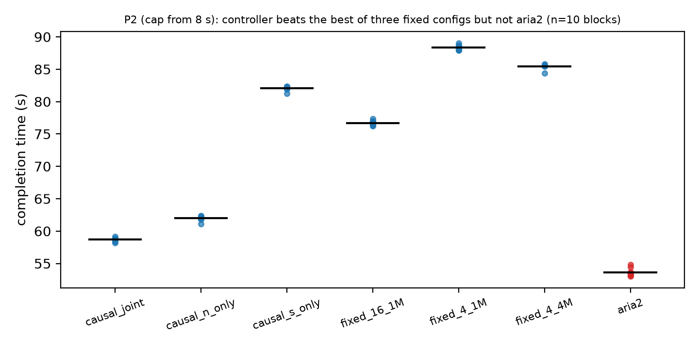

# Paper draft — working manuscript (claims corrected against raw data, 2026-10-11)

**Working title:** *Request granularity and concurrency adaptation for HTTP range
downloads under controlled server-side pacing: a mechanism-first evaluation.*

**Evidence labels used throughout.** **Confirmed** = reproduced from raw run files
with the stated n; **Descriptive** = point estimate without an inferential claim;
**Failed gate** = a predeclared criterion that was not met; **Limitation** = scope
or validity caveat. Every number in this draft is recomputed from raw artifacts by
`tools/claims_check.py`.

**Note on "pre-registered".** Protocols in this project were written to logged
documents with recorded SHA-256 hashes before the corresponding runs. They were
not deposited with an independent timestamping service, the repository history
begins with a single import commit, and one manifest was amended twice after
design output had been seen (W1–W6, §6.1; the first version was overwritten).
Wording such as "pre-registered" in older internal documents therefore means
*predeclared in a logged protocol*, not independently verifiable pre-registration.
See `docs/PREREGISTRATION_NOTE.md`.

---

## Abstract (draft)

Adaptive HTTP range downloaders choose concurrency (N) and range size (S), but it
is rarely clear when adaptation has anything causal to exploit. We build a
controlled single-server HTTP/1.1 range-download platform with per-response
pacing, a soft concurrency-dependent throttle, and network impairment, and report
four findings. (i) On one characterised workload (512 MiB; per-response pacing
640→160→2500 KiB/s; 40 ms RTT, 0.4 % loss) a fixed configuration of 16
connections and 4 MiB ranges completes **62.4 % faster than aria2 1.37** (30/30
paired runs, geometric ratio 0.3756 [0.3726, 0.3787]); controls attribute much of
the gap to an interaction between request granularity, request-start timing, and
phase-locked pacing: it shrinks when granularity is matched (ratio 0.862). A
five-pair screen over six pacing schedules shows ours faster in 28 of 30 pairs,
with the ratio ranging from 0.38 to 0.81 and reaching parity (0.998) only at a
constant slow rate (640 KiB/s), so the advantage is not confined to the D2 phase
pattern; the direction was also observed against a stock NGINX server with
per-response rate limiting (ours faster in 10/10 pairs; screening, n=5 per
configuration). (ii) Replaying five recorded cellular traces
in a controlled setup, a counterfactual oracle finds no exploitable concurrency
headroom (one-sided 95 % lower bound −0.26 % against a predeclared 10 % bar).
(iii) Under a server model we constructed in which per-request rate falls with
concurrent connections, the optimum (N,S) moves between states and a causal
controller exploits it: within a download it is 23.4 % faster than the best of
three stationary configurations (10/10 paired blocks) but slower than aria2 under
that cap; across six predeclared workloads a frozen workload selector is not
distinguishable from the per-workload best fixed configuration on average
(geometric ratio 0.999 [0.969, 1.029]) and a consistent improvement over a single
family-wide configuration is **not** established (point estimate 0.770,
workload-level interval [0.455, 1.304]). (iv) The DQN policies (v2, v5, v6) were
slower than aria2 overall in the head-to-heads we ran (LinUCB was evaluated only
descriptively). All results are scoped to the
controlled mechanisms; none is a validation on live networks or production servers.

---

## 1. Introduction

- Segmented range downloads; fixed vs adaptive N and S.
- Adaptation is useful only when the environment has a state-dependent optimum
  that a causal controller can observe.
- Contributions (each with its evidence label):
  1. A controlled, instrumented platform (downloader, server, policies, harness).
  2. A partly mechanism-explained comparison with aria2 on one characterised workload
     (**Confirmed**, single workload; sensitivity screen in §4.1).
  3. A replay-based negative result on recorded cellular traces (**Confirmed**
     under the frozen counterfactual model; not a live-network validation).
  4. Existence results for adaptive (N,S) selection/control **under an explicitly
     constructed N-dependent server model** (§6, §7): within-download improvement
     over the best stationary configuration (**Confirmed**, n=10 blocks);
     cross-workload selection (**Descriptive**; consistency across the family not
     established).
  5. An inventory of learned-policy experiments, all negative or mixed (§9).
- Scope: controlled server/network mechanisms; not claims about production servers.

## 2. Related work

All entries below were checked against an authoritative record; see
`reports/references.md` for the verification log and the list of unresolved
candidates, which are deliberately not cited.

**Online tuning of transfer parallelism.** Balaprakash et al. [balaprakash2016direct]
treat the number of parallel streams as an online optimization problem solved by
direct search on production GridFTP/Globus links. Falcon [arifuzzaman2023falcon,
arifuzzaman2021online] tunes the degree of parallelism with a utility function
and online search for high-speed science networks. FastBioDL
[swargo2025fastbiodl] applies gradient-descent concurrency tuning to HTTP/FTP
genomic downloads (arXiv preprint, no peer-reviewed venue found). These works
optimize concurrency online against observed throughput; the present paper
instead asks, with a controlled server whose mechanism is known, whether an
optimum exists for a causal controller to track at all.

**Multi-source and range-based downloading.** MDTP [abdollah2025mdtp] splits a
request into chunk requests across replica servers and sizes chunks to measured
per-server throughput, comparing against aria2 [aria2manual]. HTTP range
requests are specified in RFC 9110 [rfc9110]. Our setting is single-source.

**Adaptation in adjacent domains.** BOLA [spiteri2016bola, spiteri2020bola]
selects video bitrates by utility maximization without bandwidth prediction and
serves as an analogy for decision rules that need no throughput forecast.
DeLoad [liu2025deload] (preprint) sizes download tasks for short-video
preloading. Neither is a range-download concurrency study.

**Position.** The contribution here is a mechanism-first, controlled
evaluation with explicit failed gates and a practical baseline comparison, not
a new tuning algorithm.

## 3. System and experimental platform

- Go downloader: RangeTracker (half-open), fetcher (inclusive), assembler,
  metrics, worker pool (dynamic N, in-flight ranges immutable), concurrency and
  chunk-size controllers, policy interface, serialized policy runner.
- Controlled server: deterministic logical object; per-response pacing sampled at
  **request start and held for that response**; wall-clock rate schedules; fault
  injection; and a soft concurrency cap
  `rate_eff = min(base, C/(k*(1+gamma*(k-1))))` evaluated at request start with
  k = concurrent requests. This request-start semantics is a property of the
  server model and drives the aria2 results below.
- Harness: experiment matrix, aria2/curl/wget runners, SHA-256 content
  verification of every output, tc/netem, mm-link trace replay.

## 4. Phase-locked pacing and the aria2 comparison

- Workload D2: 512 MiB, per-response pacing 640 → 160 → 2500 KiB/s at 2 s / 4 s,
  40 ms RTT + 0.4 % loss; both systems receive the same object.
- Frozen configurations (selected on separate discovery runs): ours (16 conn,
  4 MiB); aria2 1.37 `--max-connection-per-server=16 --split=16
  --min-split-size=1M`. The full aria2 split frontier (1/2/4/8/16) and a
  40-configuration grid for ours were run in discovery.
- **Confirmed (30 fresh pairs):** ours 20.12 s vs aria2 53.56 s mean; geometric
  ratio 0.3756, 95 % CI [0.3726, 0.3787], 30/30 wins; all runs content-verified.
- **Mechanism (per-request server logs, per run):** aria2 issues 16 requests (one
  unranged probe plus 15 × 32 MiB ranges), all starting before 2 s and held at
  640 KiB/s; ours issues 128 × 4 MiB ranges, of which 16 start before 2 s and 112
  start after 4 s in the recovered phase (3840 ranged requests, 480 early / 3360
  late, over 30 runs). aria2 cannot be configured to finer
  initial pieces: with `-x16`, `--split` of 16/64/256 gave the same range-size
  distribution in a local probe.
- **Controls:** granularity-matched control ratio 0.862 [0.834, 0.890] (10
  pairs). A constant 2.5 MB/s schedule removes most of the *4 MiB vs 32 MiB*
  difference within our own downloader (2.3× → 1.1×) but ours is still faster
  than aria2 (15.3 s vs 24.8 s); see §4.1. The phase-locked mechanism therefore
  explains the size of the D2 gap, not the whole of it.
- **This is a fixed-configuration result, not an adaptive one:** neither system
  adapts during the transfer in this comparison.
- **Limitation:** one workload family on a synthetic server; the win is a
  property of this pacing mechanism, not a general statement about aria2.

### 4.1 Pacing-schedule sensitivity (screening)

Frozen protocol: `testdata/d2_pacing_sweep/manifest/sweep_manifest.json`
(committed before any run; order seed 20261011; exclusion rules fixed).
Same workload, systems, and netem as §4 (512 MiB; ours 16 conn × 4 MiB; aria2
frozen flags); only the server pacing schedule varies. **Screening only: five
pairs per schedule, no inferential claim.** 60/60 runs valid, 0 exclusions,
all content-verified.

| schedule (KiB/s; switch times s) | ours (s) | aria2 (s) | geo ratio ours/aria2 | [min, max] | ours faster |
|---|---|---|---|---|---|
| S0 D2 reference `640,160@2,2500@4` | 20.1 | 53.3 | 0.378 | [0.372, 0.389] | 5/5 |
| S1 no dip `640,2500@2` | 20.1 | 48.9 | 0.425 | [0.353, 0.751] | 5/5 |
| S2 long dip `640,160@2,2500@8` | 44.1 | 54.7 | 0.806 | [0.783, 0.827] | 5/5 |
| S3 partial recovery `640,160@2,1280@4` | 31.6 | 54.3 | 0.583 | [0.559, 0.608] | 5/5 |
| S4 constant fast `2500` | 15.4 | 27.1 | 0.568 | [0.523, 0.618] | 5/5 |
| S5 constant slow `640` | 53.8 | 53.9 | 0.998 | [0.987, 1.008] | 3/5 |

Both predeclared expectations held: S0 reproduces the historical D2 ratio
(0.378 vs 0.3756) and S5, where both systems run 16 connections at one slow
rate, is at parity. Beyond that the screen is descriptive: the advantage is
largest when the early slow phase is short relative to the transfer (S0, S1),
shrinks when the slow phase lasts longer (S2, 0.806), and persists under
constant fast pacing (S4, 0.568), where no phase-locking exists. The sweep did
not test why S4 favours the smaller ranges (an obvious candidate is the
finishing tail of 32 MiB pieces, unmeasured here), so the mechanism for S4 is
a hypothesis, not a finding. S1 has one pair at 0.751 (a slow ours run); it is
retained under the predeclared exclusion rules.

### 4.2 Stock-server check (NGINX `limit_rate` / `limit_rate_after`)

Purpose and scope: a separate screen of whether the *direction* of the aria2
comparison survives on a stock server whose rate control we did not write. It
is **not** a shared or concurrency-dependent cap: NGINX 1.24.0 `limit_rate`
limits each response independently and `limit_rate_after` leaves the first bytes
of each response unthrottled; there is no concurrency-dependent behaviour and no
connection limit. Frozen protocol:
`testdata/nginx_limit_rate/manifest/nginx_manifest.json` (committed before any
run). Same 512 MiB object (deterministic AES-CTR stream, SHA-256 verified),
netem, systems and aria2 flags as §4; 5 pairs per configuration; screening only.
20/20 runs valid.

| configuration | ours (s) | aria2 (s) | geo ratio ours/aria2 | [min, max] | ours faster |
|---|---|---|---|---|---|
| N1 `limit_rate 640k` (constant per response) | 50.3 | 58.3 | 0.863 | [0.811, 0.901] | 5/5 |
| N2 `limit_rate_after 1m; limit_rate 640k` | 33.7 | 56.4 | 0.597 | [0.574, 0.625] | 5/5 |

The predeclared expectation for N1 was parity (both systems use 16 connections
at one per-response rate, as in sweep schedule S5, which gave 0.998). **That
expectation was not met**: ours was faster in all five pairs. The check does not
identify why; the difference between S5 and N1 could come from the server
implementation (NGINX/sendfile pacing granularity), aria2's request handling
against NGINX, or the two systems' connection behaviour, and none was tested.
The result supports only the statement that the direction of the comparison
(ours faster) was also observed on a stock server under per-response rate
control in this setup.

## 5. When does adaptation help? Mechanism screens

Predeclared screens, each closed before policy work: static rate+RTT (chunk size
moves, no causal switching gain; analytical), live queueing (work-conserving; no
joint opportunity), correlated loss (S fragile, N monotone), failure-based
N-dependent throttling (abort cliff), and adaptive-N degradation (interior
optimum analytically; live mismatch). Existing adaptive heuristics on D2 adapt
but lose to the fixed optimum (joint 2.32× slower). **Conclusion:** within-download
adaptation needs a mechanism whose optimum moves in N and S and is causally
observable; none was found live in the screened mechanisms other than the
constructed soft cap of §6–§7. The same screens searched a space of server
behaviours (72 cap candidates in §6.1 alone); results in §6–§7 are existence
demonstrations in a selected environment, not prevalence estimates.

## 6. Cross-workload selection under the constructed cap

- Family: healthy server vs concurrency-capped server (C=8 MiB/s, gamma=0.05);
  stationary optima (16, 1 MiB) vs (4, 4 MiB); cross penalties +35.8 % / +252.9 %.
- Live mechanism gate (**Failed gate**; five of six predeclared checks passed):
  N* moved 16→4 and S* moved 1→4 MiB (N-margin 5.75 %, just above its 5 % bar),
  and cross-state penalties were material (+31.8 % using the healthy optimum under
  the cap; +254.4 % using the capped optimum when healthy). The local S-margin was
  3.73 % in the gate grid (3.74 %, 95 % bootstrap [3.09 %, 4.45 %], after four
  extra replicates) against a predeclared 5 % criterion; the criterion was not
  changed. Three high-N/large-S capped cells aborted at the 30 s request timeout
  and are preserved as invalid (a 20/30/60 s timeout screen left the optimum at
  (4, 4 MiB) and changed only reachability).
- Selector: probe at (16, 1 MiB), classify after ≥ 20 samples, apply the
  predeclared (N,S), no further switching. Live, 10 blocks per workload:
  healthy 19.1 s vs fixed (16,1M) 19.0 s (geo 1.006 [0.931, 1.082], 6/10) and vs
  aria2 53.9 s (geo 0.353, 10/10); capped 84.2 s vs fixed (16,1M) 115.3 s
  (geo 0.730, 10/10) and vs aria2 68.3 s (geo 1.232, 0/10: aria2 faster).
- Baselines, stated explicitly: vs the best single fixed configuration across the
  two workloads (8, 4 MiB; 36.3 s / 91.7 s) the selector gains +47.5 % / +8.2 %
  (**Descriptive**; the two workloads were designed to have different optima);
  vs the per-workload best fixed it is −3.5 % healthy and +2.6 % capped.

### 6.1 Six-workload family

Frozen manifest `testdata/n_dependent_server_joint_ns/manifest/w1_w6_manifest.json`
(predeclared in a logged protocol, but not independently timestamped):
six predeclared workloads (W1 healthy; W2–W6 cap/schedule/transition variants)
chosen by a predeclared qualification and selection rule from 72 analytic
candidates (13 qualified). Two post-hoc amendments were made after design output
and before any live W1–W6 run (post-drop window 20 samples → fixed 25 s; relaxed
transition coverage); the first manifest was overwritten and is not preserved.
W2–W4 share one selector target by construction. Live fixed-grid validation: 5/6
model optima matched; **W5 mismatched** (live argmin (16,16M) 85.4 s; the model's
target (4,4M) measured 95.9 s live against a model prediction of 94.8 s) and the frozen selector was not retuned. 10 fresh paired blocks per
workload, 240 runs, 0 invalid.

| comparison (selector vs …) | pooled geo ratio | block-level 95 % CI | workload-level (six-cluster) interval | blocks won |
|---|---|---|---|---|
| per-workload best fixed | 0.999 | [0.969, 1.029] | [0.873, 1.143] | 24/60 |
| family-best single fixed (4, 4 MiB) | 0.770 | [0.684, 0.859] | [0.455, 1.304] | 40/60 |
| aria2 | 1.660 | [1.360, 1.990] | [0.707, 3.901] | 10/60 |

**Primary comparison is the workload-level interval**, because the unit of
generalisation is the workload, not the block. It includes 1 for all three
comparisons. The 0.770 point estimate is therefore **Descriptive**: a consistent
improvement over a single family-wide configuration across the family is **not
established**. It is driven by W1 (healthy workload vs a degraded-state fixed
configuration; ratio 0.286); over W2–W6 the geometric mean is 0.94 and the
selector loses on W5 (1.058) and W6 (1.090).

| workload | vs per-workload best fixed | vs family-best fixed |
|---|---|---|
| W1 | 1.013 | 0.286 |
| W2 | 0.934 | 0.869 |
| W3 | 1.019 | 0.949 |
| W4 | 0.808 (selector runs the fast (16,1M) config until the cap appears: probe-phase timing, not better selection) | 0.765 |
| W5 | 1.172 (frozen-target mismatch) | 1.058 |
| W6 | 1.088 | 1.090 |

aria2 is faster on every degraded workload (its burst-started 32 MiB pieces start
before the cap rate drops, §7). The result is workload-level selection under the
constructed cap, not within-download adaptation.

## 7. Within-download adaptation under server degradation

- State schedule: no cap on [0, 8 s), cap on [8 s, EOF). Controller: running max
  of windowed median per-request throughput; on a drop below 0.5×, switch once to
  a predeclared target ((4,4M) joint; (4,1M) N-only; (16,4M) S-only).
- **Confirmed (10 paired blocks, 0 invalid):** causal joint 58.7 s vs best of the
  three stationary configurations run under this schedule, (16,1M) 76.7 s: geo
  0.766 [0.762, 0.769], 10/10 (+23.4 %). The comparison set is
  {(16,1M), (4,1M), (4,4M)}; no fixed grid was run under this schedule, so
  "best" means best of those three.
- Ablation: N-only 62.0 s (geo 0.808 vs best fixed, 10/10); joint vs N-only geo
  0.947 [0.943, 0.952], 10/10; S-only 82.1 s, worse than not switching (geo
  1.070, 0/10). Under this cap the N move carries the gain.
- **aria2 is faster:** 53.6 s vs causal joint 58.7 s (geo 1.096, 0/10). This
  result supports improvement over the best stationary configuration under the
  selected controlled transition, **not** superiority over aria2. Mechanism
  (per-request server logs): aria2's first nine pieces start at k ≤ 9 where the
  cap rate exceeds the base rate and hold 640 KiB/s for ~52 s; the server fixes a
  request's rate at its start.

- Block-level CIs here are very narrow because the emulated server is nearly
  deterministic; they quantify emulator noise, not population variability.

## 8. Recorded cellular traces replayed in a controlled setup

Five recorded driving traces (Verizon EVDO and LTE, AT&T LTE, T-Mobile LTE and
UMTS) were replayed through mm-link on a controlled host; this is trace replay,
not measurement on live mobile networks. A per-trace counterfactual oracle with
transition costs estimates the completion-time headroom of switching concurrency
over the best fixed C. Headroom per trace: 1.64 %, 0.019 %, 0.016 %, 0.061 %,
0.294 % (mean 0.406 %). The predeclared gate required a one-sided 95 % lower bound
≥ 10 %; the bound was −0.26 % (**Failed gate**; n = 5, df = 4). Oracles are not
policies; this bounds the benefit available to any concurrency-switching policy
under the frozen model.

## 9. Learned-policy experiments (inventory; none is a positive result)

Status column: **valid** = the stated comparison is internally consistent and
reproducible from its artifacts; **stale** = produced before a later correction
of its simulator/environment; **non-comparable** = different workload, file
size or aria2 configuration from the other rows, so ratios must not be pooled.

| experiment | design | outcome | status |
|---|---|---|---|
| LinUCB, five- and six-mode 4 MiB benchmarks | 300 runs, 5 scenarios, fixed/rule-based/LinUCB modes | descriptive; locks onto a single arm after warm-up; periodic exploration changes coverage but not the dominant preference; no ranking made | valid (descriptive), non-comparable to aria2 rows |
| DQN v1 (frozen candidate) | simulator train/validation/test + 25-run live transfer, no aria2 comparison | superseded; trained on the v1 environment later corrected (§22.24) | stale |
| DQN v2 vs aria2 baseline v1 | 240 pairs, U1–U8 profiles, 4 MiB, aria2 `-x4 -s4` | 75.7 % slower (geo 1.757 [1.672, 1.847]); faster in 31/240 pairs | valid; non-comparable to the 16 MiB rows |
| DQN v3 | simulator + live transfer vs v2 | fixed fragmentation, but simulator rewarded chunk sizes the server does not reward | valid (negative/mixed) |
| DQN v4 (concurrency-only, fixed 1 MiB) | simulator + 25-run live transfer, no aria2 comparison | live behaviour matched simulator; 4 MiB file gave only a four-request control horizon | valid; no head-to-head |
| DQN v5 vs aria2-F | 240 pairs, 16 MiB, U1–U8 | geo 2.322 [2.230, 2.417]; faster in 1/240 pairs; outperformance criteria not met | valid as a head-to-head; **candidate artifact stale** with respect to a later simulator window-accounting fix (not retrained) |
| DQN v6 (concurrency 1–16) vs aria2-F | 150 pairs, trajectories A2–E2, 16 MiB | pooled geo 1.456 [1.305, 1.624]; faster in 37/150; one of five trajectories not slower (E2, 0.948 [0.897, 1.002]); D2 5.47× slower | valid; non-comparable to v5 rows (different bounds/trajectories) |
| v6 long-duration diagnostic | 16/128/512 MiB, 5 pairs/cell, A2/D2/E2 | pooled 1.805 → 1.062 → 0.909 (512 MiB CI [0.750, 1.102] includes 1), driven by D2 (6.00 → 1.16 → 0.568) while A2 and E2 worsen with size | valid but exploratory, small n |

No learned policy outperformed the practical baseline in a supported
comparison. The single sub-1 pooled value (v6 at 512 MiB) has an interval that
includes 1 and is driven by one trajectory. Candidate artifacts are frozen with
SHA-256 hashes; none was tuned after its evaluation. Intervals in this table are
95 % t-intervals on the log ratio recomputed by `tools/claims_check.py` with the
critical value for the actual degrees of freedom; the frozen analysis script
(`python/analyze_final_evaluation.py`) used 2.045 for every n (and the frozen D2
analysis used the normal value 1.96, giving [0.3728, 0.3785] instead of the t-interval
reported here), which is correct
for n=30 and slightly conservative for n=150 and n=240 (and too narrow for
n=15), so its stored intervals differ in the third decimal. The frozen
artifacts were not modified.

## 10. Discussion, limitations, and threats to validity

- **Constructed environment.** The positive adaptive results hold under a server
  model we designed and selected (72-candidate search). They show conditions under
  which adaptation can help, not that real servers behave this way.
- **Request-start rate semantics** drive both the D2 mechanism and the aria2
  "cap escape"; a server that re-evaluates rates during a response would change
  both.
- **Single machine, single aria2 version (1.37.0), loopback + netem**; no
  real-network or production-server evaluation. The only stock-server check is
  the NGINX per-response rate-limit screen of §4.2 (n=5 per configuration), and
  it exercised neither a shared cap nor a connection limit, so the adaptive
  results of §6-§7 have no stock-server counterpart.
- **Statistics:** block-level intervals reflect emulator noise; workload-level
  intervals are primary for cross-workload claims; n = 5 sweep pairs are
  screening only.
- **Multiplicity and amendments:** the W1–W6 family was selected from 72 analytic candidates and its manifest was amended twice before the live runs; the protocol was predeclared in a logged protocol, but not independently timestamped (§6.1 and the note above).
- **Failed gates are reported as failed** (§6 S-margin; §8 trace gate).

## 11. Conclusion

A fixed 16×4 MiB configuration beats aria2 by a large margin on one
phase-locked-pacing workload; controls attribute much of that margin to
granularity, request-start timing and pacing, it shrinks when granularity is
matched, and a five-pair screen across six pacing schedules shows the direction
holds in all but a constant slow-rate schedule where the two are at parity. On recorded cellular
traces replayed in a controlled setup there is no exploitable concurrency
headroom. Adaptive control helps within a download only under a server model in
which rate depends on concurrency, where it improves on the best stationary
configuration but not on aria2; a cross-workload selector matches the
per-workload best on average but a consistent advantage over a single
family-wide configuration is not established; learned policies were slower than
aria2. These results delimit when adaptation is worth its complexity; they do not
establish general superiority of adaptive downloading.

## Declarations

**Authors, order, affiliations, ORCID, funding, conflicts of interest:** TO BE
PROVIDED BY THE HUMAN AUTHORS (not filled by the preparer).

**Use of AI tools (draft; authors must confirm wording and scope).** An AI
coding assistant (Anthropic Claude, run through the Claude Code CLI) was used
during the project to write and modify source code and analysis scripts, to run
experiments and tests, to audit results against raw data, to correct
manuscript claims, and to draft this text. It did not generate experimental
data other than by executing the specified programs. All numerical claims are
recomputed from raw run files by `tools/claims_check.py`. Human authors are
responsible for the content and must verify this disclosure against the actual
workflow and the publisher's policy.

**Data and code availability.** Code: MIT license (copyright holder to be
confirmed). Raw runs, manifests and analysis outputs are under `testdata/`;
because of size they are distributed as a separate archive with SHA-256
checksums (`docs/ARCHIVE_PLAN.md`). **DOI: not yet issued.** Third-party trace
files keep their own terms (`DATA_LICENSE.md`).

**Reproducibility.** `docs/REPRODUCING.md`; `python3 tools/claims_check.py`
recomputes every quoted number; protocols and hashes for the pacing sweep and
the NGINX check are committed before their runs.

---

## Claim → evidence map

| Claim | Label | Evidence |
|---|---|---|
| Fixed (16, 4 MiB) beats aria2 by 62.4 % on D2 (30/30, ratio 0.3756) | Confirmed (single workload) | 30-pair frozen benchmark; per-request logs |
| The D2 gap is partly attributable to granularity × request-start timing × pacing | Confirmed for the matched-granularity effect (0.862); **residual advantage unexplained** (constant fast pacing 0.568; NGINX constant 0.863) | granularity-matched control; constant-rate control; sweep S4; NGINX N1 |
| Ours is faster than aria2 across six pacing schedules except constant slow pacing (parity) | Descriptive (screen, n=5/schedule, 28/30 pairs) | `d2_pacing_sweep/analysis/sweep_results.json` |
| Ours is faster than aria2 against stock NGINX per-response rate limiting | Descriptive (screen, n=5/config, 10/10 pairs); predeclared parity expectation for N1 **not met** | `nginx_limit_rate/analysis/nginx_results.json` |
| No exploitable concurrency headroom on recorded cellular traces replayed | Confirmed under frozen model; Failed gate for any headroom claim | five-trace gate, LCB95 = −0.26 % vs 10 % |
| Soft cap creates a state-dependent joint optimum (live) | Descriptive; **Failed gate** (S-margin 3.74 % < 5 %) | gate_b.json pass=false; N*/S* moved, cross-state penalties material |
| Causal joint controller beats best stationary config within a download under the cap | Confirmed (10 blocks, best of 3 configs) | geo 0.766, 10/10 |
| …and beats aria2 | **Not supported** (aria2 faster, 0/10) | geo 1.096 |
| Selector matches per-workload best fixed on average | Descriptive (interval includes 1; not an equivalence test) | 0.999 [0.969, 1.029]; workload-level [0.873, 1.143] |
| Selector improves on a single family-wide fixed config | **Not established** | 0.770 point; workload-level [0.455, 1.304]; loses W5/W6 |
| Learned policies beat aria2 | **Not supported** | §9 |
